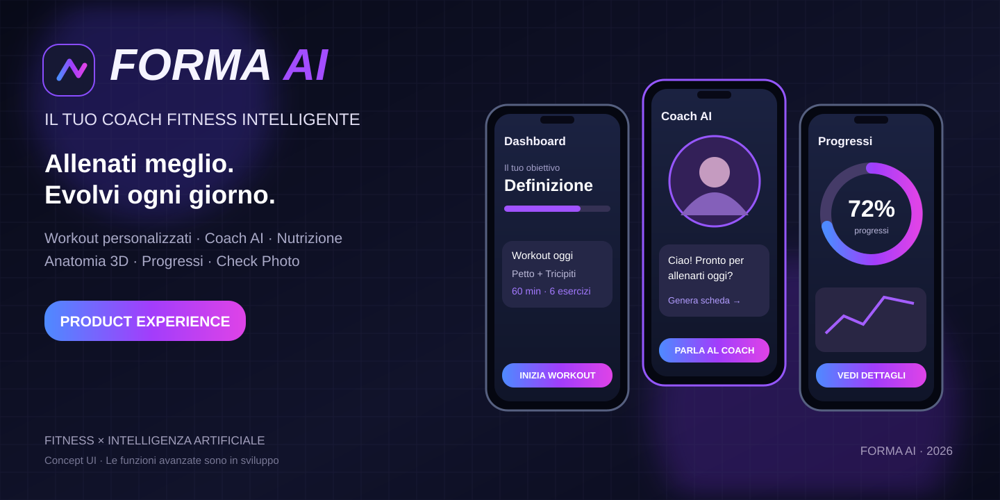
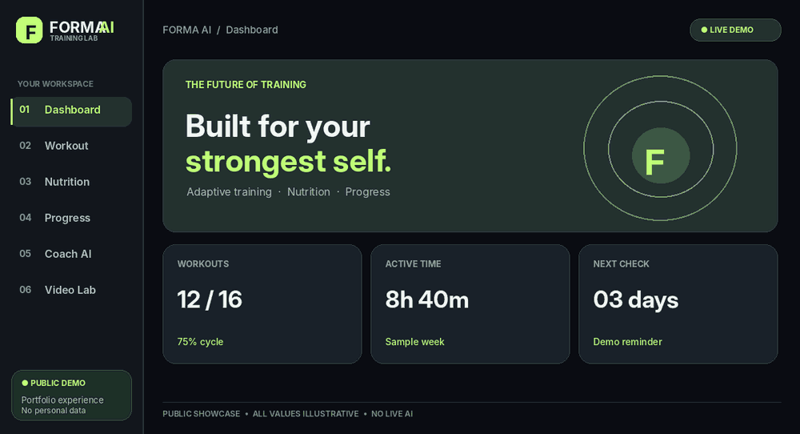

# FORMA AI — Neon Edition · Public Experience Demo

<p align="center">
  
</p>

**The fitness app that adapts to you.** *(Neon Edition — public product concept and interactive prototype.)*

**Nuovo restyling:** la demo pubblica utilizza ora la palette viola/blu Dark Neon della versione privata, con dashboard e navigazione responsive. Restano contenuti dimostrativi: il backend, i dati privati e le funzioni AI reali non sono pubblicati.

[](https://giovannidelgaudio1994.github.io/forma-ai/)


## 🧬 Novità — Muscle Atlas 3D

**[Esplora l'atlante muscolare 3D interattivo](https://giovannidelgaudio1994.github.io/forma-ai/atlante-3d.html)** · Modello umano stilizzato 3D ruotabile, selezione di 7 gruppi muscolari, vista frontale/posteriore e schede esercizio illustrative. Funziona lato browser con Three.js via CDN, senza dati personali o backend proprietario. **È una preview educativa, non un atlante clinicamente accurato né un sistema di analisi biomeccanica.**

## 👀 FORMA AI in movimento

<p align="center">
  <a href="https://giovannidelgaudio1994.github.io/forma-ai/" title="Apri la demo interattiva di FORMA AI">
    
  </a>
</p>

<p align="center"><sub>Tour visivo illustrativo delle sezioni della demo · Valori fittizi · Coach AI e Video Lab non sono funzioni operative nella preview pubblica.</sub></p>

<p align="center">
  <a href="https://giovannidelgaudio1994.github.io/forma-ai/"><strong>▶ PROVA LA DEMO INTERATTIVA</strong></a>
  &nbsp; · &nbsp;
  <a href="https://github.com/GiovanniDelGaudio1994/forma-ai/tree/main/assets">Visual assets</a>
</p>

> **This repository contains a demonstration of the FORMA AI product experience, not the commercial application or its proprietary algorithms.**

## ✨ What you can try

- **Dashboard** — elegant sport-tech interface, weekly timeline and sample metrics.
- **Workout preview** — switch among Massa, Forza, Definizione, Dimagrimento and Mantenimento and browse prewritten workout examples.
- **Nutrition** — visual recipe cards with explicit allergen warnings. No personalized or allergy-safe meal advice.
- **Check & progress** — fictional body metrics, illustration chart and photo placeholders.
- **Coach preview** — static educational examples; **there is no live AI model here**.
- **Motion Lab** — design preview only; **no video recording, uploads or form analysis**.

The preview runs entirely in the browser without sign-up, keys or backend services. It **does not collect real user fitness or health data**.

## 🧬 Next milestone: Exercise Atlas & Virtual Coach

**Product roadmap — planned, not yet implemented.** We're designing a structured exercise library with anatomy-first visualizations and a consistent virtual personal trainer.

| Feature | Concept | Status |
|---|---|---|
| Exercise knowledge base | Curated exercise metadata: muscles, equipment, movement pattern, skill level and home-gym alternatives | 🟡 Research & design |
| 3D anatomy viewer | Anatomical illustrations highlighting prime movers and supporting muscles | 🟡 Planned |
| Virtual trainer | Original branded 3D avatar demonstrating start/end positions, later short movement animations | 🟡 Planned |
| Coaching integration | Link exercise explanations and appropriate alternatives to the future adaptive coach | 🟡 Planned |
| Video form review | Carefully qualified visual feedback, requiring separate validation and consent | 🟡 Experimental concept |

**Data quality first:** no unrestricted copying of commercial fitness databases, images or videos. Exercise information will be curated from suitable sources with documented attribution and licensing, reviewed for accuracy, and supported by original or properly licensed media. 3D demonstrations are illustrations, not certified technique assessments.

**[Explore the development roadmap →](ROADMAP.md)**

---

### Open locally

Open `index.html` in a browser. No build system is required. For a local static server:

```bash
python3 -m http.server 8080
```

Then visit http://localhost:8080. No production AI APIs are used.

### Publish on GitHub Pages

Go to **Settings → Pages → Build and deployment → Source: GitHub Actions**.

A workflow in `.github/workflows/pages.yml` can publish this **static demo** after pushes to `main`. GitHub Pages deployment is not automatic until Pages is enabled and the workflow succeeds.

## 🔒 Code and commercial development

This repository intentionally does **not** contain the complete product source, the AI engine, prompt/validation system, nutritional decision logic, personal media storage, or Android application.

The full commercial version is intended for a **separate private repository** and a backend that keeps API credentials secure. An Android release will require a Play Console setup, Google Play health-app compliance, a real privacy policy and extensive safety testing before publication.

**Important historical notice:** this repository originally contained FORMA AI v0.2.0 with an MIT license. Removing code from the newest branch does *not* remove it from old Git history, forks or downloaded copies, and previously granted MIT permissions cannot automatically be revoked. A clean public demo repository and a private full-source repository are recommended before commercial launch.

## ⚕️ Health & safety

Workout and food content are clearly labeled as examples. They are **not individualized recommendations**, verified gluten-free meals, medical advice or an injury assessment. The future commercial app will require safety reviews for exercise, allergies, celiac disease, health data and video analysis.

## 📄 Rights

Copyright © 2026 Giovanni Del Gaudio. All rights reserved. Source is publicly viewable for portfolio evaluation; it is not an open-source license. See [LICENSE](LICENSE).

## 👨‍💻 Author

[GiovanniDelGaudio1994](https://github.com/GiovanniDelGaudio1994) — Software Development Portfolio.
