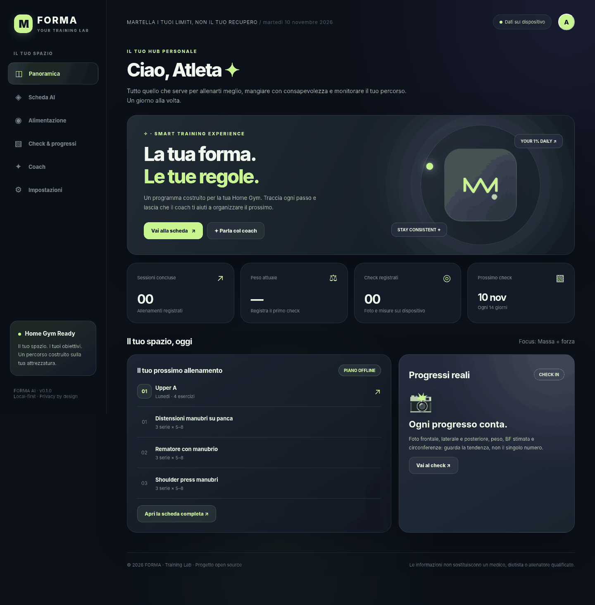
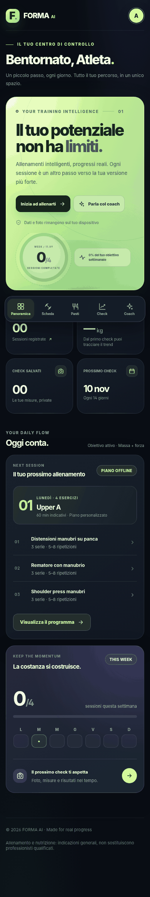

# FORMA AI — Your Training Lab

> **Una Home Gym. Un percorso davvero tuo.**

 [](https://github.com/GiovanniDelGaudio1994/forma-ai/actions/workflows/ci.yml)  



**FORMA** è una Progressive Web App responsive, completamente open-source, che unisce pianificazione degli allenamenti per la Home Gym, gestione dei progressi, check fotografici, ricette e un coach AI opzionale. Il progetto è pensato sia per l'uso personale sia per un portfolio da software developer.

## 🎨 Interfaccia v0.2.0 — Precision / Liquid Training

- Dashboard premium in stile sport-tech con hero lime, superfici scure, iconografia SVG e layout a card.
- Indicatore circolare **reale** delle sessioni completate rispetto al programma settimanale, mini-calendario settimanale e stato dei check.
- Navigazione flottante in basso su smartphone, nuove gerarchie tipografiche, stati hover/focus, responsive da 320 px e supporto a `prefers-reduced-motion`.
- Pagine Scheda, Pasti, Check, Coach e Profilo rifinite con la stessa design language.
- Identità visiva aggiornata: nuova icona SVG/PNG per l'installazione PWA.
- Verifica preliminare delle allergie alimentari nel profilo: senza screening o con allergie note, la proposta automatica dei pasti viene sospesa.



## 🚀 Avvio rapido (macOS / Windows / Linux)

Richiede **Node.js 22+**. Non serve `npm install`: il progetto usa soltanto moduli JavaScript nativi.

```bash
# Entrare nella cartella del progetto
cd forma-ai
npm start
```

Su Mac puoi anche fare doppio clic su `avvia-su-mac.command` dopo aver installato Node.js (se macOS blocca il file, avvialo da Terminale). Apri **http://127.0.0.1:8787** nel browser. Per eseguire i test:

```bash
npm test
npm run check
```

Si può avviare anche da un server statico, mantenendo le funzionalità offline: `python3 -m http.server 8080` dalla cartella del progetto. Non aprire direttamente `index.html` come `file://` (i moduli ES e il service worker richiedono un server HTTP).

## Novità v0.2.0 — FORMA Coach & Motion Lab

**Coaching adattivo, feedback e sicurezza alimentare** sono i tre pilastri del nuovo rilascio. L'interfaccia include una sezione *Video Lab*, un pannello atleta più informativo, nuove azioni nella scheda allenamento e uno screening degli allergeni prima di mostrare suggerimenti di pasti.

### Utilizzo del feedback post-allenamento

1. In **Impostazioni**, imposta età, altezza, peso, livello di attività, esperienza, attrezzi, frequenza e obiettivo.
2. Apri **Scheda AI** e completa un allenamento con **Segna completato**, oppure premi **Feedback** sulla giornata.
3. Indica **RPE** (1–10), qualità del **recupero** (1–5), difficoltà percepita ed eventuale dolore.
4. Se lasci attiva l'opzione di adattamento, il motore **offline** modifica conservativamente quella giornata: aggiunge fino a una ripetizione ai range numerici quando l'allenamento è stato facile, riduce una serie e aumenta il recupero se troppo faticoso, o espone un avviso prudenziale se segnali dolore. I carichi **non vengono mai aumentati automaticamente**.
5. Con l'AI server-side configurata, **Genera con AI** considera anche gli ultimi feedback. Il modello propone una scheda che deve superare la validazione degli esercizi/attrezzi già disponibile.

### Video Lab (beta sperimentale)

Puoi **caricare** un video locale oppure **registrarlo** dalla videocamera (richiede il permesso del browser e un'origine sicura: `localhost` o HTTPS). La ripresa rimane nella memoria della pagina e viene eliminata quando esci da Video Lab; **non viene caricata sul backend**.

Con un consenso esplicito puoi far scaricare il modulo MediaPipe Pose Landmarker, che estrae circa 12 fotogrammi nei primi 30 secondi. L'app confronta gli **angoli apparenti dei gomiti** con soglie euristiche e segnala se le differenze visive meritano di essere riviste. È **una prova tecnica non validata clinicamente**: la prospettiva, le occlusioni e le variazioni del gesto rendono i risultati incerti. Non misura l'effettivo carico sui lati, non rileva infortuni e non stabilisce se un'esecuzione è corretta. L'integrazione con modello CDN richiede Internet, e **l'analisi video reale va ancora collaudata su dispositivi fisici**.

MediaPipe elabora i frame localmente, ma la libreria può raccogliere metriche tecniche sull'uso della funzione secondo la propria [informativa npm](https://www.npmjs.com/package/@mediapipe/tasks-vision). L'interfaccia chiede il consenso prima di scaricare il modulo. Non filmare altre persone senza autorizzazione.

### Allergeni e celiachia

**Nessun menu automatico viene mostrato finché non completi lo screening nel profilo.** Lo screening propone i 14 gruppi di allergeni (cereali contenenti glutine, crostacei, uova, pesce, arachidi, soia, latte, frutta a guscio, sedano, senape, sesamo, solfiti, lupini, molluschi) e un campo per ulteriori allergie/intolleranze. **Qualsiasi allergia/intolleranza dichiarata blocca interamente i menu generati**, inclusi quelli AI, invece di fidarsi di filtri testuali. Serve una valutazione individuale con dietista e, per allergie, allergologo.

La **celiachia non equivale a un'allergia al frumento**: se è attiva la modalità celiachia e non sono segnalate altre allergie, i menu utilizzano soltanto le ricette contrassegnate come potenzialmente idonee del catalogo. Un piatto rimane sicuro solo dopo controllo degli ingredienti reali, dicitura «senza glutine» quando pertinente e prevenzione delle contaminazioni (vedi [AIC](https://www.celiachia.it/etichettatura/)).

## ✨ Funzionalità v0.2.0

| Modulo | Stato | Funzioni |
|---|---|---|
| Dashboard | ✅ | Riepilogo, obiettivi, prossimo check, attività registrata |
| Allenamento | ✅ | Obiettivi dimagrimento, definizione, mantenimento, massa + forza; piani 2–6 giorni; attrezzi Home Gym; registro carichi; feedback RPE/recupero e regole di adattamento offline prudenti |
| Alimentazione | ✅ | Menu settimanale con quattro pasti al giorno; ricette, ingredienti e procedimenti; stime nutrizionali indicative |
| Celiachia | ✅ con avvertenze | Ricette di catalogo selezionate, esclusione automatica di ricette con glutine; indicazioni obbligatorie su etichette e contaminazione |
| Allergeni | ✅ prudenziale | Screening esplicito su 14 gruppi + note. Nessun menu prima dello screening; allergie/intolleranze dichiarate sospendono ogni menu automatico |
| Check Photo | ✅ | Foto frontale/laterale/posteriore in IndexedDB; confronto di due check fotografici; peso, BF inserita manualmente, circonferenze e note |
| Progressi | ✅ | Grafico storico peso, statistiche, storico check |
| Promemoria | ✅ calendario | Evento `.ics` ricorrente con allarme importabile in Calendario; notifica browser solo mentre la pagina è aperta |
| Coach offline | ✅ | Guida tecnica per categorie di esercizi, risposte predefinite e utilizzo del feedback; non è un modello generativo |
| Coach generativo | ✅ opzionale | OpenAI Responses API lato server; riceve profilo atleta e ultimi feedback dopo invio volontario; validazione esercizi e ricette |
| Video Lab | 🧪 beta | Carica o registra video; landmarks MediaPipe sul dispositivo con consenso e rete; indicazioni visive conservative sui gomiti. Analisi video reale da collaudare |
| PWA | ✅ | Installabile e navigabile offline dopo il primo caricamento |
| Privacy | ✅ local-first | Dati sul dispositivo; chiave API solo nel backend; export JSON per dati testuali |

## 🤖 Attivare il coach AI reale

Il piano offline è un **generatore basato su regole**, non un modello AI: l'app mostra correttamente quale modalità è in uso. Per abilitare l'AI generativa:

1. Copia `.env.example` in `.env`.
2. Imposta `OPENAI_API_KEY=...` in `.env` **soltanto sul server**, mai nel client né in GitHub.
3. Avvia `npm start` e visita http://127.0.0.1:8787.
4. Premi **Genera con AI** nella scheda di allenamento, **Menu con AI** nell'alimentazione oppure apri **Coach**.

Il modello predefinito è `gpt-5.4-mini`, modificabile attraverso `OPENAI_MODEL`. La chiamata avviene via OpenAI **Responses API**. Il codice chiede output JSON strutturato, verifica che gli esercizi siano compatibili con l'attrezzatura selezionata e, per i menu, accetta esclusivamente gli ID di ricette presenti nel catalogo locale; in caso di risultato non conforme lo scarta. **Il modello non può aggiungere ricette di sua invenzione nel piano per celiaci.**

L'API può generare costi a consumo in base al proprio account. Se la chiave manca o la rete è assente, la PWA continua a funzionare offline.

### Pubblicare su GitHub Pages

La workflow `.github/workflows/deploy.yml` pubblica il frontend alla push su `main`. Su GitHub, abilita **Settings → Pages → Build and deployment → GitHub Actions**. **Il frontend statico pubblicato non include il backend AI**: per l'AI serve un server Node protetto (oppure un endpoint HTTPS gestito personalmente); inserisci il relativo URL nelle Impostazioni. Per un server esposto devi configurare `HOST=0.0.0.0`, `COACH_ACCESS_TOKEN` segreto e `ALLOWED_ORIGINS=https://TUO_USERNAME.github.io`. HTTPS obbligatorio in produzione. Prevedi comunque autenticazione, rate limiting e gestione dei costi prima di distribuire il backend a utenti terzi; il token del backend non va pubblicato. Per l'uso individuale è consigliato tenerlo su localhost.

### Installare sul telefono

Apri l'URL HTTPS del sito dal browser del telefono: in Safari usa **Condividi → Aggiungi alla schermata Home**; in Chrome l'opzione di installazione web app. Le foto sono conservate nel browser del dispositivo e **non sincronizzate** automaticamente fra telefono e Mac. Prima di cancellare il sito/browser salva separatamente anche le foto: il backup JSON contiene misure e sessioni ma non file fotografici.

## 🔐 Privacy e considerazioni di sicurezza

- Funziona senza account: non esiste un database cloud e non vengono caricate foto a server esterni.
- Profilo, allenamenti, check e chat offline sono in `localStorage`; foto compresse in `IndexedDB`.
- Il backend AI riceve quando lo richiedi **obiettivo, esperienza, giorni/durata, attrezzi, peso, altezza, età, livello di attività, eventuali limitazioni, celiachia/allergie e ultimi feedback**; nella chat riceve il messaggio. Se lo abiliti esplicitamente nel profilo, riceve anche **un riepilogo numerico** dei progressi (peso, BF, vita, sessioni), mai fotografie o check completi.
- La **BF viene inserita manualmente**, non stimata da foto attraverso AI.
- Token del server AI mantenuto solo in memoria nella scheda aperta; API key solo backend.
- Prima di condividere il progetto: **non committare** `.env`, foto personali o backup.

## 🍽️ Limiti sanitari importanti

FORMA non è un medico, dietista o personal trainer certificato. Le calorie delle ricette sono stime indicative, non un regime clinico personalizzato. In caso di celiachia, una ricetta contrassegnata come compatibile **non è una garanzia**: è necessario controllare la dicitura «senza glutine» sui prodotti a rischio, la filiera e le contaminazioni durante la preparazione. Evitiamo l'avena nel catalogo; il suo inserimento, se previsto, richiede prodotti garantiti e un confronto medico secondo le indicazioni AIC. Allergie dichiarate => nessuna generazione automatica di pasti.

Fonti: [Associazione Italiana Celiachia — Etichettatura](https://www.celiachia.it/etichettatura/), [AIC — Contaminazioni](https://www.celiachia.it/dieta-senza-glutine/gestire-dieta-senza-glutine/le-contaminazioni/), [AIC — Avena](https://www.celiachia.it/faq/sono-celiaco-posso-consumare-avena/).

## 🧩 Architettura

```text
forma-ai/
├── index.html                  # App shell / UI
├── assets/styles.css           # Design responsive glassmorphism
├── assets/icon.svg + PNG        # PWA e icone iOS
├── src/app.js                   # Viste, eventi e flussi UI
├── src/adaptive.js              # Adattamento offline del piano da RPE e recupero
├── src/technique.js             # Guide tecniche educative
├── src/motion.js                # Analisi video sperimentale MediaPipe
├── src/data.js                  # Libreria esercizi e ricette
├── src/planner.js               # Pianificazione deterministica / validatori
├── src/storage.js               # LocalStorage, IndexedDB, foto, export, ICS
├── src/ai.js                    # Client HTTP del coach
├── server/index.mjs             # Web server + security / API proxy
├── server/coach.mjs             # OpenAI Responses API + JSON schema e validazioni
├── tests/                       # Test Node.js
├── .github/workflows/deploy.yml # CI / Pages
├── manifest.webmanifest
└── sw.js                         # Service worker PWA
```

## 🛠️ Evoluzione prevista

- Storico dettagliato per serie (oltre al registro serie rappresentativa) e progressioni per ciclo di allenamento.
- Funzioni fotografiche avanzate e export/backup locale di tutte le immagini.
- Notifiche push vere con backend/consenso, sincronizzazione opzionale cifrata.
- Ricette cliniche personalizzate solo dopo revisione da dietista e revisione professionale degli allergeni.
- Validazione del Video Lab su dispositivi reali, con riprese frontali/laterali ed eventuali modelli di stima più avanzati.
- Login e multi-device, app nativa Flutter se serve una distribuzione sugli store.

## Licenza

MIT. Vedi `LICENSE`.

## 🤝 Contribuzioni e repository

- [CONTRIBUTING.md](CONTRIBUTING.md) contiene istruzioni per contribuire.
- La cartella `.github/` include CI, template delle issue e pull request.
- Non pubblicare mai foto, misure e feedback personali nel repository.
- Per il profilo sviluppatore visita [GiovanniDelGaudio1994](https://github.com/GiovanniDelGaudio1994).
