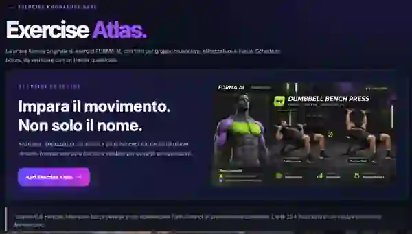
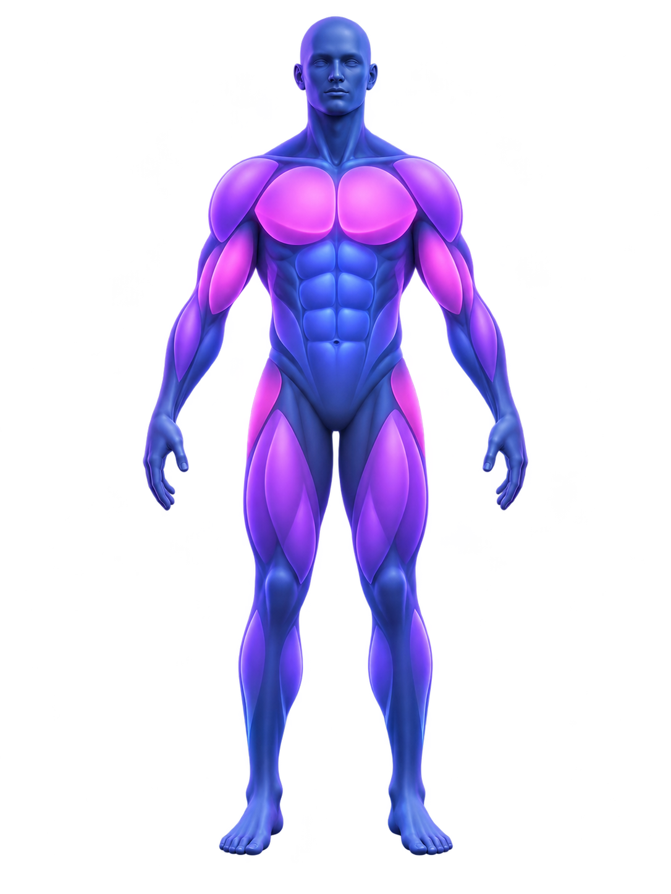
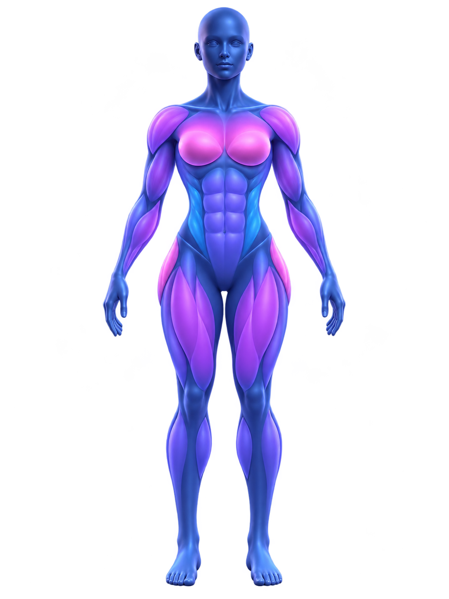

# FORMA AI — Neon Edition · Public Experience Demo

> **Repository organization / Organizzazione:** per il momento questo repository ospita anche il **build del portfolio** e alcune demo pubbliche. La riorganizzazione in repository distinti (`portfolio` e `LegacyBridge`) è in preparazione e non è ancora avvenuta. La versione completa di FORMA AI resta in `forma-ai-private`, privato. [Piano di migrazione senza interruzioni](docs/GITHUB_REPOSITORY_REORGANIZATION.md).
>
> **Licenze / Licenses:** la presentazione FORMA AI resta coperta dalle sue condizioni specifiche. La piccola sonda pubblica LegacyBridge in `projects/legacybridge/` è invece concessa sotto **GNU AGPL-3.0-only**, come indicato dalla licenza locale. Un badge FORMA AI non deve essere interpretato come licenza di tutti i progetti ospitati temporaneamente qui.


<p align="center">
  
</p>

**The fitness app that adapts to you.** *(Neon Edition — public product concept and interactive prototype.)*

**Nuovo restyling:** la demo pubblica utilizza la palette viola/blu Dark Neon e incorpora una sezione Exercise Atlas dedicata, con anteprime uomo/donna, categorie muscolari e collegamento al viewer 3D interattivo. Restano contenuti dimostrativi: il backend, i dati privati e le funzioni AI reali non sono pubblicati.

[](https://giovannidelgaudio.it/forma-ai-demo/)


## 🧬 Novità — Muscle Atlas 3D

**[Esplora l'atlante muscolare 3D interattivo](https://giovannidelgaudio.it/atlante-3d.html)** · Modelli corporei stilizzati 3D Uomo/Donna selezionabili, preferenza salvata localmente, rotazione e selezione di 7 gruppi muscolari, vista frontale/posteriore e schede esercizio illustrative. Funziona lato browser con Three.js via CDN, senza dati personali o backend proprietario. **È una preview educativa, non un atlante clinicamente accurato né un sistema di analisi biomeccanica.**

## 👀 Anteprima FORMA AI — Neon Edition & Exercise Atlas

### La schermata Exercise Atlas del concept

[](https://giovannidelgaudio.it/forma-ai-demo/#atlas)

**[▶ Apri Exercise Atlas nella demo pubblica](https://giovannidelgaudio.it/forma-ai-demo/#atlas)** · **[🧬 Apri il visualizzatore 3D uomo/donna](https://giovannidelgaudio.it/atlante-3d.html)**

Questa è la schermata di riferimento del prodotto, adesso visibile anche nella demo Neon Edition. La rappresentazione della distensione con manubri è illustrativa; il catalogo completo di 50 schede resta una bozza privata non validata e non è pubblicato come prescrizione personalizzata.


<p align="center">
  <a href="https://giovannidelgaudio.it/forma-ai-demo/" title="Apri la nuova demo FORMA AI">
    
  </a>
</p>

<p align="center">
  <a href="https://giovannidelgaudio.it/atlante-3d.html" title="Apri l'atlante interattivo">
    
    
  </a>
</p>

<p align="center"><sub>La nuova demo presenta una schermata Exercise Atlas integrata, anteprime uomo/donna e il visualizzatore 3D pubblico. I contenuti sono illustrativi e non revisionati clinicamente; Coach AI e Video Lab restano preview.</sub></p>

<p align="center">
  <a href="https://giovannidelgaudio.it/forma-ai-demo/"><strong>▶ PROVA LA DEMO INTERATTIVA</strong></a>
  &nbsp; · &nbsp;
  <a href="https://github.com/GiovanniDelGaudio1994/forma-ai/tree/main/assets">Visual assets</a>
</p>

> **This repository contains a demonstration of the FORMA AI product experience, not the commercial application or its proprietary algorithms.**

## ✨ What you can try

- **Dashboard** — elegant sport-tech interface, weekly timeline and sample metrics.
- **Workout preview** — switch among Massa, Forza, Definizione, Dimagrimento and Mantenimento and browse prewritten workout examples.
- **Nutrition** — visual recipe cards with explicit allergen warnings. No personalized or allergy-safe meal advice.
- **Check & progress** — fictional body metrics, illustration chart and photo placeholders.
- **Coach preview** — static educational examples; **there is no live AI model here**.
- **Motion Lab** — design preview only; **no video recording, uploads or form analysis**.

The preview runs entirely in the browser without sign-up, keys or backend services. It **does not collect real user fitness or health data**.

## 🧬 Next milestone: Exercise Atlas & Virtual Coach

**Current status: educational atlas preview available; advanced coaching remains planned.** The public demo contains a stylized, interactive male/female 3D anatomy viewer and HD illustrations. A validated exercise knowledge base, accurate motion simulation and an adaptive virtual trainer are **not** implemented in this preview.

| Feature | Concept | Status |
|---|---|---|
| Exercise knowledge base | Curated exercise metadata: muscles, equipment, movement pattern, skill level and home-gym alternatives | 🟡 Research & design |
| 3D anatomy viewer | Interactive illustrative male/female models with basic group selection; not clinically or biomechanically validated | 🟢 Educational demo available — advanced features planned |
| Virtual trainer | Original branded 3D avatar demonstrating start/end positions, later short movement animations | 🟡 Planned |
| Coaching integration | Link exercise explanations and appropriate alternatives to the future adaptive coach | 🟡 Planned |
| Video form review | Carefully qualified visual feedback, requiring separate validation and consent | 🟡 Experimental concept |

**Data quality first:** no unrestricted copying of commercial fitness databases, images or videos. Exercise information will be curated from suitable sources with documented attribution and licensing, reviewed for accuracy, and supported by original or properly licensed media. 3D demonstrations are illustrations, not certified technique assessments.

**[Explore the development roadmap →](ROADMAP.md)**

---

### Open locally

Open `index.html` in a browser. No build system is required. For a local static server:

```bash
python3 -m http.server 8080
```

Then visit http://localhost:8080. No production AI APIs are used.

### Publish on GitHub Pages

Go to **Settings → Pages → Build and deployment → Source: GitHub Actions**.

The existing `.github/workflows/pages.yml` builds and publishes the **portfolio with all public demos** to the custom domain `https://giovannidelgaudio.it/`. The FORMA AI showcase is at `/forma-ai-demo/`; the root `/` is the developer portfolio. A migration to a dedicated `portfolio` repository is planned but not yet complete.

## 🔒 Code and commercial development

This repository intentionally does **not** contain the complete product source, the AI engine, prompt/validation system, nutritional decision logic, personal media storage, or Android application.

The full commercial version is intended for a **separate private repository** and a backend that keeps API credentials secure. An Android release will require a Play Console setup, Google Play health-app compliance, a real privacy policy and extensive safety testing before publication.

**Important historical notice:** this repository originally contained FORMA AI v0.2.0 with an MIT license. Removing code from the newest branch does *not* remove it from old Git history, forks or downloaded copies, and previously granted MIT permissions cannot automatically be revoked. A clean public demo repository and a private full-source repository are recommended before commercial launch.

## ⚕️ Health & safety

Workout and food content are clearly labeled as examples. They are **not individualized recommendations**, verified gluten-free meals, medical advice or an injury assessment. The future commercial app will require safety reviews for exercise, allergies, celiac disease, health data and video analysis.

## 📄 Rights

Copyright © 2026 Giovanni Del Gaudio. All rights reserved. Source is publicly viewable for portfolio evaluation; it is not an open-source license. See [LICENSE](LICENSE).

## 👨‍💻 Author

[GiovanniDelGaudio1994](https://github.com/GiovanniDelGaudio1994) — Software Development Portfolio.


## Politica delle licenze dei progetti pubblici

Le licenze sono **specifiche di ciascun componente** e non equivalgono a una licenza unica per l'intero portfolio:

- **[LegacyBridge — sonda read-only](projects/legacybridge/LICENSE): GNU AGPL-3.0-only** sul piccolo modulo originale pubblicato.
- **[SignalScope — motore Python](projects/scraper/LICENSE): GNU AGPL-3.0-only** sul codice originale pubblico.
- **[Meteo Bash 2D](projects/meteo-bash2d/LICENSE): GNU AGPL-3.0-only** sulla nuova implementazione originale; codice e contenuti di terzi conservano le licenze rispettive.
- **FORMA AI, DriveGlass e altri prototipi privati:** codice applicativo non pubblicato; non vengono presentati come AGPL.
- **Demo, materiali universitari, Fit Zone e risorse grafiche:** diritti e provenienza da verificare per ogni componente; nessuna applicazione automatica della AGPL a opere di terzi.

La **AGPLv3 non impedisce la copia né protegge l'idea in sé**: autorizza l'uso e le modifiche del codice sotto specifici obblighi, incluso il rilascio del sorgente nelle circostanze previste. I marchi, i dataset, gli asset e le dipendenze di terze parti possono avere condizioni diverse. Per componenti proprietari non distribuiti si applicano le condizioni specifiche del relativo titolare.
