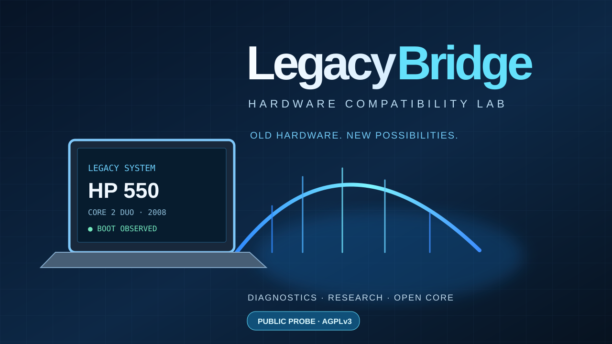

# LegacyBridge — Hardware Compatibility Lab

[🇮🇹 Italiano](README.md) · 🇬🇧 **English**

**Old hardware. New possibilities.** Responsible research and diagnostics for legacy PCs.



## Case study #001 — HP 550

| Observation | Current finding |
|---|---|
| Laptop | HP 550 · 2008 generation |
| Processor | Intel Core 2 Duo T5670 · 1.80 GHz |
| CPU architecture | Intel 64 / x64 capable, confirmed |
| Installed system | Windows 10 Pro 1909 · 32 bit, boot observed |
| Memory | Approximately 3 GiB |
| Firmware | Legacy BIOS |
| SATA drive | Identifies as “SSD 4TB”; **physical capacity not verified** |
| Linux Live x64 | Not tested yet |
| Windows 11 | Not tested and **not officially compatible** |

The project distinguishes actual measurements from assumptions. This processor generation is not expected to provide POPCNT or SSE4.2; a CPUID measurement on the specific laptop is still pending. Installer bypasses cannot add missing CPU instructions.

## Public diagnostic probe

The publicly released component is a **small, original Windows PowerShell 5.1 read-only probe**, not the complete experimental lab.

It reports CPU name, data/address width, memory, Windows version and storage device metadata in JSON. It does **not** detect CPU flags via CPUID, alter the system, write files, contact external servers or verify actual SSD capacity.

Review [probe_windows_readonly.ps1](probe_windows_readonly.ps1), then from PowerShell:

```powershell
powershell.exe -NoProfile -File .\probe_windows_readonly.ps1
```

No administrator privileges are required. Please remove personal identifiers before posting diagnostic screenshots or reports.

## Next experiments

1. Back up important data before any further disk or OS tests.
2. Boot a suitable 64-bit Linux Live image from USB **without installing** it.
3. Check CPU instruction flags with CPUID and document the results.
4. Investigate the SSD that claims 4 TB: the firmware-reported capacity alone is not proof of actual storage. Avoid write-intensive testing until data is safe.
5. Publish honest compatibility findings, including unsuccessful tests.

## Live demo and portfolio

- [LegacyBridge interactive lab (English)](https://giovannidelgaudio.it/legacybridge-demo/en/)
- [Developer portfolio (English)](https://giovannidelgaudio.it/en/)

## Licensing and scope

The public original source code is licensed under **GNU AGPL-3.0-only** — see [LICENSE](LICENSE). It may be copied, modified and redistributed subject to the license; AGPL is not a no-copy license. The LegacyBridge name and project identity are handled separately from the code license.

**No Microsoft-owned ISO, DLL, patched kernel, activation tool or third-party proprietary binary is included.** This is independent, experimental research and is not affiliated with Microsoft, HP or Intel.

Copyright © 2026 Giovanni Del Gaudio.
