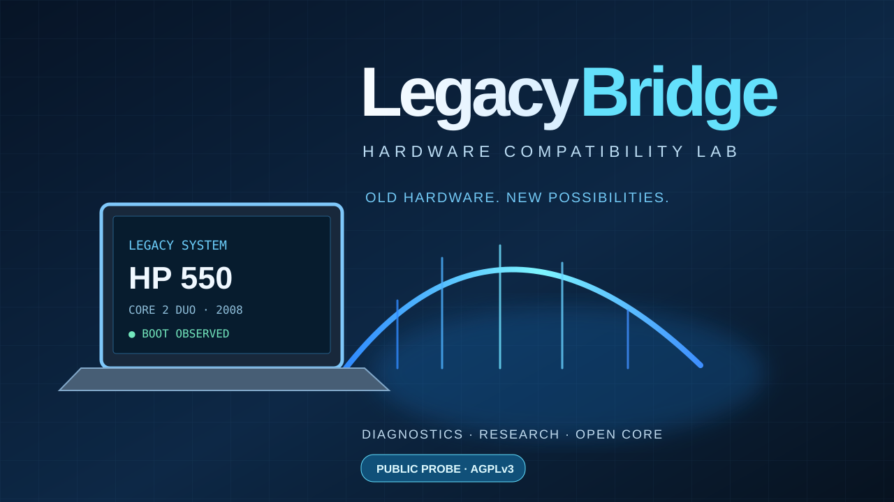

# LegacyBridge — Hardware Compatibility Lab

🇮🇹 **Italiano** · [🇬🇧 English](README.en.md)

**Old hardware. New possibilities.** Ricerca e diagnostica responsabile sui computer legacy.



## Case study #001 — HP 550

- **CPU:** Intel Core 2 Duo T5670 · 1,80 GHz · capacità Intel 64 confermata
- **OS osservato:** Windows 10 Pro 1909, **32 bit**, avviato correttamente
- **RAM riportata:** circa 3 GiB
- **Firmware:** BIOS Legacy
- **Unità SATA:** modello dichiarato `SSD 4TB`; **capacità fisica non verificata**
- **Linux Live x64:** ancora da provare
- **Windows 11:** non testato, **non certificato compatibile**; il bypass dei requisiti non fornisce istruzioni CPU mancanti.

**Strategia del progetto:** LegacyBridge è destinato a uno sviluppo **proprietario** se gli esperimenti avranno esito positivo. Questo repository pubblico conserva soltanto la sonda diagnostica read-only già rilasciata e la documentazione; il codice del prodotto futuro non sarà pubblicato automaticamente.

### Esecuzione (Windows PowerShell)

Salva `probe_windows_readonly.ps1` sul computer di test, leggi il sorgente, quindi esegui con PowerShell 5.1:

```powershell
powershell.exe -NoProfile -File .\probe_windows_readonly.ps1
```

Non necessita amministratore; stampa JSON in console e **non** cambia firmware, disco o partizioni. Per verificare POPCNT/SSE4.2 occorre un vero CPUID (non basta WMI). Non pubblicare log personali o identificatori.

### Demo e percorso

- [Demo pubblica LegacyBridge](https://giovannidelgaudio.it/legacybridge-demo/)
- [Sito portfolio](https://giovannidelgaudio.it/)
- Step successivo: creare backup, avviare antiX Live x64 da USB, leggere CPUID e controllare la salute del supporto senza scriverci dati.


## Ricerca aperta e casi studio

- [HP 550 e Windows 11: il primo caso studio](https://giovannidelgaudio.it/legacybridge-demo/hp-550/)
- [Contribuisci con un report hardware anonimizzato](CONTRIBUTING.md)

### Licenza e attribuzioni

**LegacyBridge (sviluppi futuri): proprietario, codice completo non distribuito.** L'attuale sonda originale `probe_windows_readonly.ps1` è **già stata pubblicata sotto GNU AGPL-3.0-only**: per quella versione valgono i permessi e gli obblighi previsti dalla [LICENSE](./LICENSE), che non possono essere revocati retroattivamente. Questa concessione non estende automaticamente AGPLv3 a nuovi moduli proprietari indipendenti. Per futuri moduli derivati o combinati dalla sonda AGPL occorre verificare attentamente la compatibilità delle licenze. Il nome e l'identità grafica del progetto sono trattati separatamente dal codice.

Progetto indipendente, **non affiliato** a HP, Intel o Microsoft. Nessun file Windows, patch del kernel, ISO o codice di terzi è distribuito qui.
