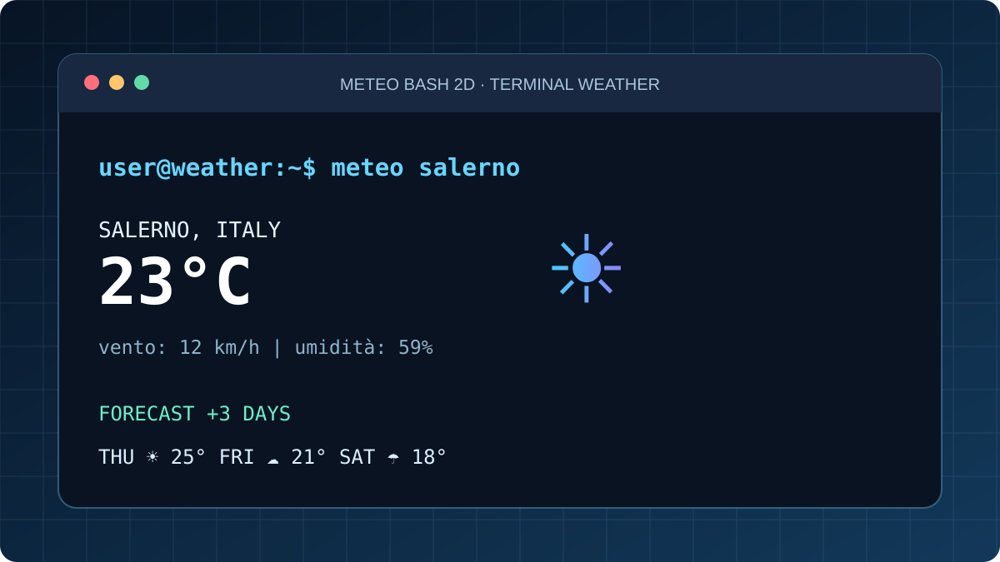

# Meteo Bash 2D — terminal weather, public project



[▶ **Apri la demo web live**](https://giovannidelgaudio.it/meteo-bash2d-demo/) · [Portfolio](https://giovannidelgaudio.it/)

**Progetto personale originale (2020), modernizzato nel 2026.**

Il progetto allegato originariamente comprende una UI Bash con grandi numeri ASCII, informazioni meteorologiche, refresh e previsione a 3 giorni. Il codice originale usa OpenWeatherMap e dipende da un progetto precedente, `bash-weather` di szantaii, distribuito con licenza **GPL-3.0 o successiva**. La cartella di terze parti e gli eventuali file di chiave API dell'archivio non sono ripubblicati qui. La paternità delle componenti preesistenti resta ai rispettivi autori.

## Prova la versione moderna da terminale

```bash
bash projects/meteo-bash2d/source/meteo.sh Salerno
bash projects/meteo-bash2d/source/meteo.sh Roma
```

Richiede Bash, Python 3 e curl. Interroga Open-Meteo direttamente senza chiavi API: stampa condizioni correnti e tre giorni di previsione. Città supportate: Salerno, Roma, Milano, Napoli e Pisa. Non include auto-geolocalizzazione.

## Demo pubblica

La [demo web live](https://giovannidelgaudio.it/meteo-bash2d-demo/) ricostruisce l'esperienza grafica del terminale in HTML/CSS/JS, con richieste reali a Open-Meteo. Non è un emulatore Bash eseguito nel browser. Se l'API non risponde, la demo mostra un errore anziché inventare dati.

## Stato e attribuzioni

- Script moderno `source/meteo.sh`: implementazione autonoma e minimale dell'interfaccia meteorologica.
- Originale del 2020: conservato nell'archivio fornito dall'autore, ma non integralmente ripubblicato per evitare divulgazione di chiavi e confusione sulle licenze dei componenti terzi.
- Interfaccia demo: indipendente da Bash e senza dati hardcoded presentati come attuali.
- Dati meteorologici: [Open-Meteo](https://open-meteo.com/), da verificare rispetto ai termini d'uso per eventuale impiego commerciale.

© 2026 Giovanni Del Gaudio, per i contributi originali.
