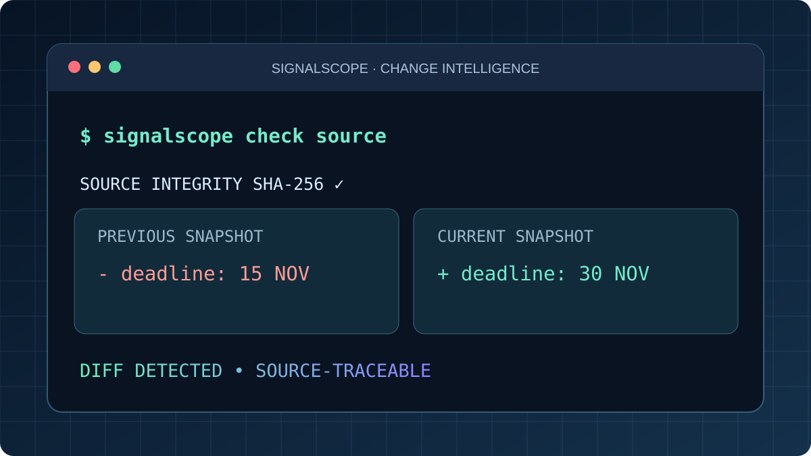

# SignalScope / Scraper — Explainable Source Intelligence



[▶ **Demo interattiva**](https://giovannidelgaudio.it/signalscope-demo/) · [Portfolio](https://giovannidelgaudio.it/)

**La differenza non è trovare un cambiamento: è spiegare cosa è cambiato, da dove arriva e perché potrebbe essere importante.**

SignalScope è un prototipo Python con codice pubblico per monitorare **pagine pubbliche autorizzate**, conservarne snapshot e mostrare differenze leggibili. L'analisi restituisce tag spiegabili per scadenze, requisiti, opportunità e modifiche economiche: un motore di regole, **non** un classificatore AI o una previsione automatica. Ogni segnale richiede verifica umana.

## Il problema

Scadenze di bandi, opportunità e avvisi possono cambiare senza comunicazioni evidenti. SignalScope rende il monitoraggio **trasparente e verificabile** senza costruire un crawler aggressivo.

## Demo web

La [demo SignalScope](https://giovannidelgaudio.it/signalscope-demo/) confronta due testi editabili nel browser: è illustrativa e non chiama siti esterni. Il motore Python sottostante implementa anche SHA-256, history SQLite e controlli robots.txt.

## Usa il motore CLI

Richiede Python 3.10+; non ha dipendenze aggiuntive.

```bash
python3 projects/scraper/source/signalscope.py check https://example.org/
python3 projects/scraper/source/signalscope.py history https://example.org/
python3 -m unittest discover -s projects/scraper/tests -v
```

Il database SQLite viene creato localmente come `signalscope.sqlite3`. Puoi personalizzare il percorso con `--db ./monitor.sqlite3`.

### Cosa è implementato

- Rispetto di robots.txt e rifiuto se il file non è verificabile
- Host HTTP(S) pubblici, restrizioni redirect, 15 s timeout, limite 1 MB
- Estrazione testo HTML, snapshot SHA-256 e persistenza SQLite
- Diff unificato da versione a versione ed esportazione JSON
- Analisi esplicabile **rule-based** per parole come `scadenza`, `proroga`, `requisiti`, `finanziamento`, `revocato`, con livello di priorità indicativo
- Test unitari senza chiamate di rete

### Caso d'uso

Un ente cambia la scadenza di un avviso dal 15 al 30 novembre. SignalScope conserva la versione precedente, segnala la riga modificata, assegna il tag `deadline` ed esporta la prova del cambiamento con impronta SHA-256. Il contenuto resta da verificare alla fonte.

### Origini del progetto

Lo ZIP `Scraper.zip` fornito dall'autore contiene anche un **mini-scraper finanziario Python del 2020** che recuperava serie storiche Yahoo Finance e tracciava medie mobili. Si tratta di un progetto precedente e distinto, non del codice qui presentato come SignalScope. SignalScope è una nuova evoluzione per il portfolio, non una rinominazione di quel programma.

## Roadmap

1. Monitor schedulato con quote di accesso per dominio, retry e log strutturati.
2. Selezione di aree del documento, RSS, export CSV/Atom.
3. Dashboard con filtri, notifiche opt-in e triage dei cambiamenti.
4. Feed verificabili con URL, timestamp, provenienza e gestione delle modifiche successive.

**Non ancora presenti:** fetch JavaScript dinamico, notifiche, multiutente, dashboard cloud, scraping finanziario live. Non sono previste tecniche per aggirare login, CAPTCHA o limitazioni dei siti.

## Sicurezza

La protezione DNS inclusa non è sufficiente contro ogni possibile race DNS/SSRF; SignalScope non deve essere esposto come API multiutente senza controlli di rete aggiuntivi. Nessun dato da pagine private o protette. Prima di monitorare un sito, verificare termini d'uso e condizioni d'accesso.

© 2026 Giovanni Del Gaudio — codice originale SignalScope.


## Licenza del codice pubblico

Il **codice originale SignalScope** contenuto in `source/` e nei test originali è distribuito sotto **[GNU AGPLv3 (AGPL-3.0-only)](LICENSE)**. La licenza permette copia, modifica e ridistribuzione nel rispetto degli obblighi di copyleft e delle condizioni relative al codice sorgente; non protegge le idee astratte e non è un divieto di riuso. I servizi, contenuti e marchi di terze parti conservano i rispettivi diritti.
